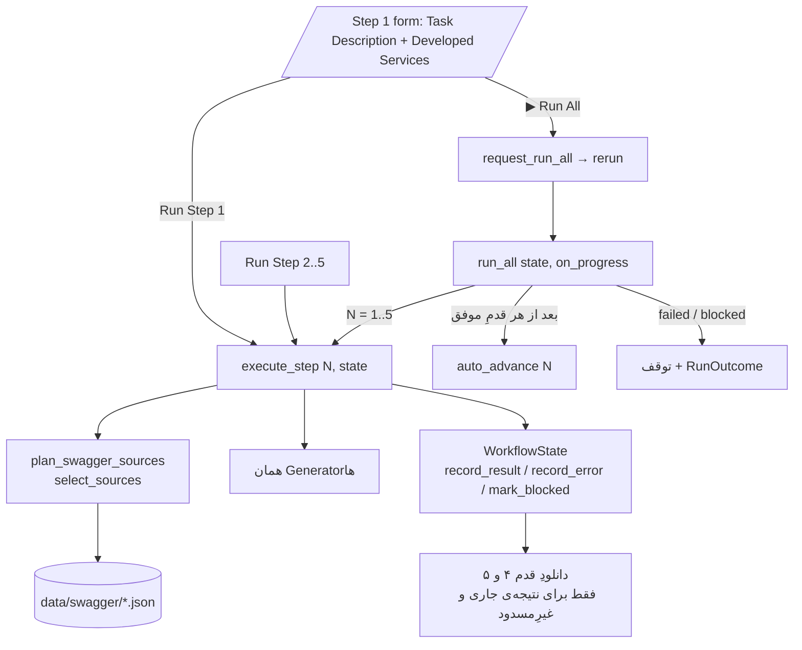

# اجرای جریانِ پنج‌قدمی، Run All، وضعیت و صادرات

> **فاز ۲ — پیاده‌سازی‌شده.** این سند رفتارِ فعلیِ ویزارد را توصیف می‌کند:
> اجرای مشترکِ قدم‌ها (`execute_step`)، اجرای خودکارِ پنج قدم (`run_all` و
> دکمه‌ی Run All)، انتقالِ URLهای سرویس از قدم ۱ به قدم ۲، وضعیت‌های نمایشی،
> رفتارِ خطا و صادرات.
>
> جزئیاتِ داخلیِ هر ماژول (پرامپت‌ها، اعتبارسنجی‌ها، ساختِ Postman، هدرِ
> Authorization و متغیرهای درخواستی) در
> [project-architecture.md](project-architecture.md) آمده و اینجا تکرار نمی‌شود.
>
> برچسب‌ها: **[پیاده‌شده]** = در کد هست و تست دارد؛
> **[پیشنهادی]** = طراحیِ آینده (اجرای دسته‌ای، آپلود به Jira)، هنوز پیاده نشده.
> ورودیِ تسک از Jira پیاده شده است: [jira-integration.md](jira-integration.md).

---

## A. نمای کلی

### هدفِ برنامه

ویزاردِ Streamlit در `ui/app.py` از توصیفِ یک تسکِ توسعه و snapshotِ
Swaggerِ سرویس‌ها یک **Postman Collection v2.1** می‌سازد. LLM فقط در قدم‌های
۱ تا ۳ معنا را تفسیر می‌کند؛ قدم‌های ۴ و ۵ کاملاً قطعی‌اند. هیچ API ای اجرا
نمی‌شود و هیچ کالکشنی run نمی‌شود.

### اجزای اصلی

| لایه | فایل‌ها | مسئولیت |
|------|---------|---------|
| پوسته‌ی ویزارد | `ui/app.py` | نوارِ قدم‌ها، بدنه‌ی قدمِ جاری، دکمه‌ی تأیید، پنلِ زنده و نتیجه‌ی Run All، sidebar |
| وضعیتِ جریان | `ui/workflow.py` → `WorkflowState` | نتیجه‌ها، تأییدِ انسانی، پذیرشِ خودکار، کهنه‌شدن، مسدود، خطاها، ورودی‌ها، قفلِ Run All — **بدونِ Streamlit** |
| اجرای قدم‌ها | `ui/pipeline.py` | `run_*` (فراخوانیِ هر Generator)، `execute_step`، `run_all`، `plan_swagger_sources` — **بدونِ Streamlit** |
| انتخابِ منابعِ Swagger | `source_selection.py` | `select_sources` — URLِ Swagger، مسیرِ endpoint و متنِ تسک در برابرِ متادیتای snapshotها (بخش D) |
| صفحه‌ی هر قدم | `ui/step1_…` تا `ui/step5_….py` | فرم/دکمه، spinner، نمایشِ نتیجه؛ اجرا را به `ui/pipeline.py` می‌سپارد؛ هر صفحه مستقل هم اجراپذیر است |
| نمایشِ مشترک | `ui/components.py`، `ui/formatting.py` | ورودی‌های رسیده، درخواستِ Run All، جدول‌ها، `collection_json`/`collection_filename` |
| منابعِ Swagger | `swagger_snapshots.py` | رجیستریِ پنج منبع (`SWAGGER_SOURCES`)، خواندنِ snapshot، تطبیقِ URL با منبع (`resolve_service_urls`)، تازه‌سازی |
| منطقِ قدم‌ها | `src/agents/test_case_generator/*.py` | یک کلاسِ `…Generator` با `generate(...)` برای هر قدم — بدونِ تغییر در این فاز |

### دو مسیرِ کاربر [پیاده‌شده]

- **قدم‌به‌قدم (بدونِ تغییر):** «Run Step N» → بازبینی → «Approve & Continue to
  Step N+1». تأیید قدمِ بعد را *اجرا نمی‌کند*، فقط بازش می‌کند.
- **Run All:** کاربر در قدم ۱ توصیفِ تسک و Developed Services را وارد می‌کند و
  «▶ Run All — Steps 1 to 5» را می‌زند. قدم‌های ۱ تا ۵ پشتِ سرِ هم اجرا
  می‌شوند؛ هیچ کلیکِ Run/Approve/Next دیگری لازم نیست. پایان روی قدم ۵ با همان
  دکمه‌ی دانلودِ قبلی.

---

## B. ساختارِ مخزن (بخش‌های مربوط به جریان)

```
ui/
├── app.py                     # main → (Run All معلق؟) → outcome/notice/indicator/step/footer/sidebar
├── workflow.py                # WorkflowState + ثابت‌ها (STEP_COUNT، INPUT_*، STATUS_*)
├── pipeline.py                # run_* ، execute_step، run_all، plan_swagger_sources (بدونِ Streamlit)
├── components.py              # render_propagated_inputs، request_run_all/take_run_all_request
├── formatting.py              # جدول‌ها + collection_json / collection_filename / postman_collection
├── swagger_refresh.py         # ماشینِ حالتِ دکمه‌های Update
├── step1_task_analysis.py     # فرم: Run Step 1 + Run All
├── step2_api_mapping.py       # رادیوی منبع + جدولِ URLهای سرویس + Run Step 2
├── step3_scenario_analysis.py # Run Step 3
├── step4_postman_generation.py# نامِ کالکشن + Run Step 4 (+ دانلود)
└── step5_final_review.py      # Run Step 5 (+ دانلود، با export_unavailable_reason)
src/agents/test_case_generator/
├── api_discovery.py           # + swagger_group_name (گروهِ Swagger از URL، بدونِ شبکه)
├── swagger_snapshots.py       # رجیستری، extract_urls، is_swagger_url، source_for_url، resolve_service_urls
├── source_selection.py        # select_sources → SourceSelection (انتخابِ خودکار/دستیِ منابع)
├── source_semantics.py        # تحلیلِ معناییِ تسک (فارسی/انگلیسی) — LLM، پاسخِ ساختاریافته
└── prompts/step2_source_selection.md
tests/unit/ui/test_pipeline.py                       # execute_step، run_all، URL→قدم ۲، دانلود
tests/unit/ui/test_app_wizard.py::TestRunAllButton   # کلیکِ واقعیِ Run All روی runtimeِ Streamlit
tests/unit/test_case_generator/test_service_urls.py  # تطبیقِ URL با منبع
```

اجرای ویزارد: `uv run --group ui streamlit run ui/app.py`.

---

## C. اجرای یک قدم — `execute_step(step, state)` [پیاده‌شده]

پیش از این فاز، «ورودی را جمع کن → Generator → ثبت» داخلِ handlerِ دکمه‌ی هر
صفحه بود و بدونِ رندرِ صفحه اجرا نمی‌شد. حالا فقط یک پیاده‌سازی دارد
(`ui/pipeline.py:432`) و دکمه‌ها و `run_all` هر دو آن را صدا می‌زنند:

```text
execute_step(step, state) -> StepOutcome(step, status, error, recorded)
  1. قدم ۱ بدونِ Task Description → failed، recorded=False (وضعیت دست نمی‌خورد)
  2. payload = state.step_inputs(step); بالادستِ غایب/کهنه → failed، recorded=False
     (همان پیام‌های قبلیِ دکمه‌ها)
  3. قدم ۲: plan (از Run All) یا plan_swagger_sources(state) → swagger_selection؛ خطا؟ record_error(2). وگرنه
     INPUT_SWAGGER_SOURCES (مسیرِ snapshotها) و INPUT_SWAGGER_SNAPSHOTS (اثرانگشت)
  4. قدم‌های ۱–۳ داخلِ state.track_usage(step)
  5. run_task_analysis / run_api_mapping / run_scenario_analysis /
     run_postman_generation / run_final_review → (result, error)
  6. خطا یا unusable_reason(step, result) → record_error → failed
  7. record_result؛ قدم ۵ با review.status=blocked → mark_blocked → blocked
  8. وگرنه completed
```

- `run_*` همان try/exceptها و **همان متنِ پیام‌های خطای** قبلی را دارند؛
  صفحه‌های مستقل هم همین‌ها را (داخلِ `st.spinner`) صدا می‌زنند. پس فراخوانیِ
  هر Generator فقط یک‌جا نوشته شده است.
- `compact_step2_result` حالا داخلِ `run_scenario_analysis` است، نه در UI.
- `execute_step` قدم را تأیید یا پذیرش نمی‌کند — این کارِ فراخوان است.
- **`unusable_reason`:** آخرین سدِ شکل، تا «برگشت بدونِ استثنا» به‌تنهایی
  موفقیت نباشد: قدم ۱ `test_cases` (list)، ۲ `mappings`، ۳ `scenarios`، ۴
  `collection` (dictِ غیرخالی)، ۵ `review` با status شناخته‌شده و
  `artifacts.postman_collection` غیرخالی. Generatorها خودشان قرارداد را
  اعتبارسنجی می‌کنند؛ این بررسی فقط شکل است.

### جدولِ قدم‌ها

| قدم | محرکِ دستی | فراخوانی | ورودی | خروجی (`state.results[N]`) |
|-----|-----------|----------|-------|------------------------------|
| ۱ | `form_submit_button` در `ui/step1_task_analysis.py:213` | `TaskAnalysisGenerator.generate(task_description, user_id, developed_services)` | Task Description (اجباری)، Developed Services | `TaskAnalysisResult` |
| ۲ | `st.button` در `ui/step2_api_mapping.py:399` | `Step2ApiMappingGenerator.generate(step1_result, service_sources=[], user_id, snapshot_keys=plan.keys)` | نتیجه‌ی ۱ + **URLهای Developed Services** + انتخابِ رادیو | `Step2Result` |
| ۳ | `st.button` در `ui/step3_scenario_analysis.py:282` | `compact_step2_result` و بعد `Step3ScenarioAnalysisGenerator.generate` | نتیجه‌ی ۱ و ۲ | `Step3Result` |
| ۴ | `form_submit_button` در `ui/step4_postman_generation.py:314` | `Step4PostmanGenerator(collection_name).generate(step1, step2, step3)` | نتیجه‌ی ۱–۳ (قدم ۲ کامل) + نامِ کالکشن | `Step4Result` |
| ۵ | `st.button` در `ui/step5_final_review.py:375` | `FinalReviewGenerator.generate(step1, step2, step3, step4)` | نتیجه‌ی ۱–۴ | `Step5Result` |

`user_id`ها همان مقدارهای قبلی‌اند (`pipeline.USER_IDS`).

---

## D. انتخابِ منابعِ Swagger برای قدم ۲ [پیاده‌شده]

### علتِ ریشه‌ای

- **فاز ۱:** handlerِ قدم ۲ همیشه `_run(step1_result, "", snapshot_keys=keys)` را
  صدا می‌زد و `keys` فقط از رادیو می‌آمد؛ URLهای قدم ۱ هرگز به قدم ۲ نمی‌رسیدند.
- **فاز ۲:** URLهای Swagger به منبع نگاشت شدند، ولی رجیستری فقط Admin و Customer
  را داشت، URLِ endpoint (مثلاً `…/api/admin/voucher/12`) «فقط زمینه» بود، متنِ
  تسک اصلاً بررسی نمی‌شد و بدونِ URLِ Swagger همیشه `both` (Admin + Customer)
  خوانده می‌شد. انتخابِ رادیو هم که یک بار با Run Step 2 ذخیره می‌شد، در
  Run Allهای بعدی باقی می‌ماند و منابعِ اجرای تازه را تعیین می‌کرد.

### رجیستری — `swagger_snapshots.SWAGGER_SOURCES` (تنها تعریفِ منبع)

| کلید | گروه (`urls.primaryName`) | snapshot | `path_prefixes` |
|------|---------------------------|----------|-----------------|
| `admin` | `Admin` | `admin.json` | `/admin` |
| `customer` | `Customer` | `customer.json` | `/customer` |
| `crm` | `CRM` | `crm.json` | `/crm` |
| `provider` | `Provider` | `provider.json` | `/provider` |
| `site` | `Site` | `site.json` | — (مسیرهای بی‌پیشوند مثلِ `/serviceSet`) |

فیلدهای `SwaggerSource`: `key`، `label`، `filename`، `remote_url` (برای Update و
`source_url`)، `primary_name` (خالی = `label`)، `path_prefixes`، `base_paths`
(پیشوندِ gateway در URLِ کامل، پیش‌فرض `/api`) و `enabled`.

- `remote_url` هر گروه `http://podium-back.devpod.ir/api/v3/api-docs/<group>` است،
  همان الگوی Admin و Customer. نشانیِ CRM، Provider و Site از همین الگو آمده
  و هنوز در دسترس بودنشان بررسی نشده؛ snapshotشان هم هنوز در `data/swagger/`
  نیست (دکمه‌ی Update هر منبع آن را می‌گیرد).
- **ثبت‌شده** (در رجیستری) ≠ **فعال** (`enabled=True`، مجاز برای انتخاب) ≠
  **دارای snapshot** (فایل روی دیسک) ≠ **انتخاب‌شده برای این اجرا** ≠ **دارای
  عملیاتِ مرتبط** (شاهدِ endpoint/متادیتا). صفحه‌ی قدم ۲ همه را در یک جدول
  نشان می‌دهد.

**افزودنِ ACL:** یک ردیف — `_registered("acl", "ACL", ("/acl",))` (یا
`SwaggerSource(...)` با `primary_name`/`base_paths` دلخواه) — و snapshotِ آن در
`data/swagger/acl.json` (دکمه‌ی «Update ACL» خودکار ظاهر می‌شود). اگر مسیرهای
ACL پیشوندِ متمایز ندارند، `path_prefixes=()` بگذارید: مالکیت با متادیتای
snapshot ثابت می‌شود. هیچ کدِ دیگری عوض نمی‌شود؛ تستِ
`test_the_algorithm_has_no_source_specific_branch` بررسی می‌کند که
`source_selection.py` هیچ نامِ منبعی ندارد.

### URLِ Swagger در برابرِ URLِ endpoint

| ورودی | نوع | اثر |
|-------|-----|-----|
| `…/swagger-ui/index.html?urls.primaryName=CRM#/…` | Swagger UI | منبعِ CRM (فرگمنت بی‌اثر) |
| `…/v3/api-docs/Provider` | سندِ خامِ OpenAPI | منبعِ Provider |
| `…/swagger-ui/index.html?urls.primaryName=Billing` | Swagger، گروهِ ثبت‌نشده | **خطا** |
| `https://podium-admin.sandpod.ir/api/admin/voucher/12?x=1` | endpoint | مسیرِ `/admin/voucher/12` (پس از حذفِ `/api`) |
| `GET /serviceSet/{serviceSetId}/webServices` در متن | endpoint (مسیرِ خام) | بررسی در متادیتای snapshotها |

میزبان در شناختِ گروه شرط نیست (sandpod و devpod همان گروه‌اند)؛ URLی که
گروهی نام نمی‌برد فقط با تطبیقِ کاملِ `remote_url` شناخته می‌شود. هر دو متنِ
قدم ۱ (Developed Services و Task Description) جست‌وجو می‌شوند.

### الگوریتم — `source_selection.select_sources(task, services, *, manual="", analyze=None)`

بدونِ شبکه؛ فقط از رجیستری و snapshotهای محلی. تنها جزءِ غیرقطعی تحلیلِ
معناییِ تسک (گامِ ۳) است که فقط در صورتِ نیاز صدا زده می‌شود و هر ادعایش با
snapshot تأیید می‌شود.

1. **URLِ Swagger** (`resolve_service_urls`) → منبع. گروهِ ثبت‌نشده یا منبعِ
   غیرفعال → خطا.
2. **مسیرِ endpoint** (`endpoint_references`): مسیر قطعه‌به‌قطعه با الگوی هر
   عملیاتِ هر snapshotِ فعال مقایسه می‌شود (`{id}` با هر مقدار؛ کوئری،
   اسلشِ پایانی و `/api` نادیده)؛
   - در یک snapshot پیدا شد → همان منبع؛
   - در چند snapshot → اگر URLِ Swagger یا پیشوند یکی را مشخص کند همان، وگرنه
     **خطای تعارض**؛
   - در هیچ snapshotی نیست ولی پیشوندِ ثبت‌شده‌ی یک منبع (قطعه‌ی کامل:
     `/administrator` با `/admin` نمی‌خواند) → همان منبع، با هشدارِ «snapshot
     شاید قدیمی است»؛
   - هیچ‌کدام → به هیچ منبعی نسبت داده نمی‌شود (هرگز خودکار Site نیست).
3. **تحلیلِ معناییِ تسک (چندزبانه)** — بخشِ «تحلیلِ معنایی» در پایین. وقتی
   صدا زده می‌شود که شاهدِ ۱ و ۲ نباشد، یا باشد ولی متنِ تسک حروفِ غیرِلاتین
   (فارسی) داشته باشد. اگر به کار رفت، جایگزینِ گامِ '۳ است.
3'. **متنِ تسک ↔ متادیتا (قطعی، فقط وقتی تحلیلِ معنایی به کار نرفت):** واژه‌های تسک (camelCase/kebab جدا، ریشه‌ی ساده،
   بدونِ واژه‌های عمومی و **بدونِ نامِ منابع**) با مسیر، operationId و tag (وزنِ
   ۱) و summary/description (وزنِ ۰٫۵) هر عملیات، با وزنِ IDF، مقایسه می‌شوند.
   امتیازِ منبع = بهترین عملیاتش.
   - بدونِ شاهدِ ۱ و ۲: منابعی که ≥ ۸۰٪ بهترین امتیاز را دارند (دو منبعِ
     هم‌امتیاز هر دو انتخاب می‌شوند).
   - **چندسرویسی:** منبعِ دیگری اضافه می‌شود اگر (الف) بهترین عملیاتش ≥ ۲ واژه‌ی
     تسک را بپوشاند و واژه‌ای داشته باشد که در هیچ عملیاتِ منابعِ
     انتخاب‌شده نیست، یا (ب) تسک نامش را ببرد («customer») **و** عملیاتی منطبق
     با تسک داشته باشد. نامِ منبع به‌تنهایی هیچ منبعی را انتخاب نمی‌کند.
4. **اعتبارسنجی:** هر منبعِ انتخاب‌شده باید فعال باشد و snapshot داشته باشد،
   وگرنه خطا با مسیرِ فایل و دلیلِ نیاز به آن.
5. **شاهدِ ناکافی** → خطای ابهام (فهرستِ snapshotهای بررسی‌شده و ناموجود و
   راه‌حل‌ها). هیچ fallbackی به `both` یا هر منبعِ ثابتِ دیگری نیست.

نمونه‌ها (با snapshotهای ساختگیِ تست‌ها):

| ورودی | منابع | شاهد |
|-------|-------|------|
| `https://…/api/admin/voucher/123` | Admin | endpoint → `GET /admin/voucher/{id}` |
| `?urls.primaryName=CRM` یا `GET /crm/digitalService/requests` | CRM | Swagger URL / endpoint |
| `/provider/serviceSet/123` | Provider | endpoint → `GET /provider/serviceSet/{id}` |
| `/serviceSet/123/webServices` | Site | endpoint، فقط چون در snapshotِ Site هست |
| تسکِ «List the digital service requests» بدونِ URL | CRM | تحلیلِ معنایی (بدونِ LLM: متادیتا) |
| «ادمین بتواند جزئیات ووچر را مشاهده کند.» | Admin | تحلیلِ معنایی → `GET /admin/voucher/{id}` |
| «مشتری بتواند درخواست خدمات دیجیتال ثبت کند.» | CRM (نه Customer) | تحلیلِ معنایی → `GET /crm/digitalService/requests` |
| «کاربر بتواند لیست سرویس‌های یک ServiceSet را مشاهده کند.» | Site | تحلیلِ معنایی → `GET /serviceSet/{serviceSetId}/webServices` |
| endpointِ Admin + «…the customer sees it on the official invoices» | Admin + Customer | endpoint + متادیتا |
| «Fix the bug reported yesterday» | — | خطای ابهام |

### تحلیلِ معنایی — `source_semantics.py` + تأیید در `source_selection.py`

**مشکل:** کاربران تسک را فارسی یا آمیخته می‌نویسند ولی مسیر، operationId، tag و
summaryِ Swagger انگلیسی‌اند؛ تطبیقِ واژه‌ای («ووچر» ≠ «voucher») کار نمی‌کند.
از طرفِ دیگر واژه‌ی مشترک (voucher در Admin و Customer) به‌تنهایی نشان نمی‌دهد که
تسک به هر دو نیاز دارد.

**روش:** یک فراخوانیِ `LLMClient` (همان کلاینت، `temperature=0`، `user_id`ِ
قدم ۲، `agent_name="source_selection"`) با پرامپتِ
`prompts/step2_source_selection.md`:

- ورودی: متنِ تسک (هر زبانی) و **خلاصه‌ی فشرده‌ی منابع** (`catalog_summary`):
  برای هر منبعِ فعال شناسه، پیشوندها و هر tag با تعدادِ عملیات و دو نمونه‌ی
  `METHOD /path — summary`؛ منبعِ بدونِ snapshot فقط با نام و «snapshot not
  available». هیچ سندِ کاملی فرستاده نمی‌شود (Admin + Customerِ واقعی ≈ ۲۴KB).
- مدل تسک را در زبانِ خودش می‌فهمد و **به انگلیسی و با واژگانِ Swagger** پاسخ
  می‌دهد: `required_operations` (منبع، `operation` = «METHOD /path» فقط اگر در
  نمونه‌ها بود، توضیح، `relevant_keywords` مثلِ `voucher`، `digitalService`،
  `serviceSet`)، `relevant_sources` (با confidence)، `is_cross_service`،
  `needs_clarification`، `clarification_reason`.
- `parse_analysis` شکل را سخت‌گیرانه می‌سنجد (نوعِ هر فیلد، حداکثر ۵۰ آیتم).

**تأیید (هیچ ادعایی بی‌بررسی پذیرفته نمی‌شود):**

| ادعای مدل | بررسی | نتیجه |
|-----------|-------|-------|
| `source_id` | با کلید/برچسب/گروهِ رجیستری (بی‌حساسیت به حروف) | ناشناخته یا غیرفعال → نادیده + هشدار |
| `operation` | باید عیناً (متد + الگوی مسیر) در snapshotِ **همان** منبع باشد | ساختگی یا از منبعِ دیگر → رد؛ با کلیدواژه نجات داده نمی‌شود |
| `relevant_keywords` | دست‌کم min(2، تعدادِ کلیدواژه‌های مفید) باید در **یک** عملیاتِ همان منبع بخوانند (قطعه‌ی کاملِ مسیر مثلِ `serviceSet`، یا واژه‌های مسیر/operationId/tag)؛ نامِ منابع و واژه‌های عمومی («list»، «details») مفید نیستند | بدونِ تطابق → رد + هشدار |
| منبعِ بدونِ snapshot | قابلِ تأیید نیست | اگر چیزِ دیگری انتخاب نشد → خطای «snapshot not available» با مسیرِ فایل؛ وگرنه هشدار |
| `relevant_sources` و `confidence` | در انتخاب اثری ندارند | منبعِ «مرتبط» بدونِ عملیاتِ تأییدشده فقط در هشدارِ «Related but not selected» می‌آید |
| `needs_clarification` | — | بدونِ عملیاتِ تأییدشده → خطای ابهام با دلیلِ مدل |

**رابطه ≠ نیاز:** منبع فقط وقتی انتخاب می‌شود که دست‌کم یک عملیاتِ لازم در
snapshotِ خودش تأیید شده باشد (شاهد: `semantic`، «task analysis, verified
operation»). اگر مدل فقط عملیاتِ voucherِ Admin را لازم بداند، Customer انتخاب
نمی‌شود حتی اگر عملیاتِ voucher داشته باشد یا مدل آن را با اطمینانِ بالا «مرتبط»
بداند. کارِ چندسرویسی یعنی عملیاتِ تأییدشده از چند منبع.

**تقدم:** URLِ Swagger و endpoint همیشه می‌مانند؛ تحلیلِ معنایی فقط منبع **اضافه**
می‌کند و هرگز منبعِ صریح را حذف نمی‌کند. با شاهدِ صریح و متنِ انگلیسی LLM اصلاً
صدا زده نمی‌شود. در حالتِ دستی هم هرگز.

**خطا و قابلیتِ اطمینان:**

- پاسخِ بریده → بدونِ تلاشِ دوباره شکست؛ JSONِ نامعتبر یا شکلِ نادرست → یک بار
  (`MALFORMED_JSON_RETRIES`، همان سیاستِ قدم ۲) با یادآوری؛ خطای شبکه/سرویس →
  بدونِ تلاشِ تازه. هیچ retryِ دیگری اضافه نشده.
- بعد از شکست (`semantic = "failed"`): شاهدِ صریح نگه داشته می‌شود و شکست هشدار
  است؛ بدونِ شاهدِ صریح، تطبیقِ قطعیِ واژه‌ها (گامِ '۳) امتحان می‌شود و اگر چیزی
  نیافت، خطای ابهام با متنِ شکست («Task analysis failed: …»). هرگز حدس.
- مصرفِ توکنِ تحلیل جزوِ مصرفِ قدم ۲ ثبت می‌شود (`track_usage(2)`).
- پیش‌نمایشِ صفحه‌ی قدم ۲ LLM را صدا نمی‌زند (`semantic = "not_run"`) و این را
  با یک پیامِ اطلاع می‌گوید؛ بعد از اجرا همان انتخابی نشان داده می‌شود که نتیجه‌ی
  جاری با آن ساخته شده.

خروجی `SourceSelection`: `keys`، `mode` (`auto`/`manual`)، `evidence` (منبع، نوع،
جزئیات)، `endpoints`، `urls`، `searched`، `unavailable`، `warnings`، `error`،
`semantic` (`""`/`used`/`failed`/`not_run`)؛
`summary()` برای UI و `to_dict()` برای لاگ (بدونِ URLهای ورودی). `execute_step(2)`
آن را در `WorkflowState.swagger_selection` نگه می‌دارد و در لاگِ
`source_selection` ثبت می‌کند.

### خودکار و دستی

- **پیش‌فرض خودکار است** (`SELECTION_AUTO`). قدم ۲ یک رادیوی «Automatic
  (recommended) / Choose manually» دارد؛ «دستی» یک multiselect از منابعِ فعال
  است و با Run Step 2 به‌صورتِ `admin,crm` ذخیره می‌شود (`both`ِ قدیمی هنوز
  خوانده می‌شود: Admin + Customer).
- انتخابِ دستی **جایگزین نمی‌شود**؛ فقط با URLِ Swaggerِ صریح سنجیده می‌شود
  (منبعِ URL بیرون از انتخاب → خطا) و endpointهای بیرون از آن هشدار می‌گیرند.
- **Run All همیشه خودکار است:** در شروع `INPUT_SWAGGER_SELECTION` را `auto`
  می‌کند (انتخابِ دستیِ اجرای قبلی نشت نمی‌کند). انتخاب در هر اجرا **یک بار**،
  در قدم ۲ (با تحلیلِ معنایی و داخلِ ثبتِ مصرفِ توکنِ قدم ۲) ساخته می‌شود؛
  قدم‌های ۳ تا ۵ فقط نتیجه‌ی قدم ۲ را می‌خوانند، پس کلِ اجرا یک مجموعه منبع می‌بیند. منابعِ استفاده‌شده زیرِ پیامِ
  نتیجه‌ی Run All نوشته می‌شوند.
- خطای انتخاب در قدم ۲ ثبت می‌شود (`record_error(2)`) و Run All با
  `failed_step=2` می‌ایستد؛ نتیجه‌ی قدم ۱ می‌ماند و کاربر می‌تواند در قدم ۲
  منبع را دستی انتخاب و ادامه دهد.
- `INPUT_DEVELOPED_SERVICES` و `INPUT_SWAGGER_SELECTION` ورودیِ قدم ۲ هستند؛
  تغییرشان بعد از اجرا نتیجه را «out of date» نشان می‌دهد.

---

## E. Run All — `run_all(state, *, start=1, on_progress=None) -> RunOutcome` [پیاده‌شده]

```text
run_in_progress؟ → RunOutcome(rejected) — هیچ قدمی اجرا نمی‌شود
_start_error: start=1 بدونِ Task Description، یا قدم‌های پیش از start بدونِ نتیجه‌ی جاری → failed
run_in_progress = True ; last_run = None
auto_advance(1..start-1)
start <= 2 → swagger_selection = auto   (انتخاب در execute_step(2) یک بار ساخته می‌شود)
invalidate_from(start)            ← همه‌ی نتیجه‌های قدیمیِ start..5 «کهنه» می‌شوند
for step in start..5:
    go_to(step); running_step = step; on_progress(step, "running")
    outcome = execute_step(step, state)
    running_step = 0; on_progress(step, outcome.status)
    failed  → RunOutcome(failed,  failed_step=step, error) ; توقف
    blocked → RunOutcome(blocked, failed_step=step, error) ; توقف
    auto_advance(step)
همه موفق → RunOutcome(succeeded)
finally: run_in_progress = False؛ اگر استثنا قطعش کرد → RunOutcome(interrupted) و استثنا بالا می‌رود
         notice = "" ؛ last_run = outcome
```

`RunOutcome`: `status` (`succeeded`/`failed`/`blocked`/`interrupted`/`rejected`)،
`start`، `completed_steps`، `last_completed_step`، `failed_step`، `error`.

- **ترتیبی:** هیچ قدمِ وابسته‌ای هم‌زمان اجرا نمی‌شود؛ هیچ retryِ تازه‌ای
  اضافه نشده (فقط همان retryهای داخلِ Generatorها).
- **پذیرشِ خودکار ≠ تأیید:** `auto_advance` در `WorkflowState.auto_advanced`
  ثبت می‌شود، نه `approved`. قدمِ بعد را باز می‌کند، ولی نوار آن را «☑️ done by
  Run All — not reviewed» نشان می‌دهد، `progress_text` آن را جدا می‌شمارد و
  پاورقیِ قدم دکمه‌ی تأییدِ انسانی را نگه می‌دارد. `approve` بعدی آن را به
  تأییدِ انسانی تبدیل می‌کند.
- **ازسرگیری:** `run_all(state, start=N)` فقط اگر قدم‌های ۱..N-1 نتیجه‌ی جاری
  (نه کهنه، نه مسدود) داشته باشند. UI امروز همیشه از قدم ۱ شروع می‌کند.

### UI [پیاده‌شده]

1. **کلیک** (فرمِ قدم ۱، دکمه‌ی دوم): Task Description خالی → فقط خطا. وگرنه
   ورودی‌ها در وضعیت ثبت، `request_run_all()` و `st.rerun()`.
2. **اجرای بعدی** (`ui/app.py:113`): `take_run_all_request()` پرچم را **پیش از**
   اجرا برمی‌دارد (قطعِ اجرا آن را خودکار تکرار نمی‌کند)، یک `st.status` با
   placeholderِ متنیِ پنج قدم می‌کشد و `run_all` را با `on_progress` صدا
   می‌زند. پنل دکمه ندارد و بقیه‌ی صفحه تا پایانِ اجرا کشیده نمی‌شود. بعد
   `st.rerun()`.
3. **نتیجه** (`_render_run_outcome`): موفق → `st.success` (با یادآوریِ «بازبینی
   نشده» و محلِ دانلود)؛ failed/blocked → `st.error` با شماره و عنوانِ قدم و
   پیامِ کامل و فهرستِ قدم‌های تکمیل‌شده؛ interrupted → `st.warning`. دکمه‌ی
   Dismiss.
4. دکمه‌ی Run All و دکمه‌های نوار وقتی `run_in_progress` است غیرفعال‌اند؛ ویزارد
   پس از موفقیت روی قدم ۵ و پس از شکست روی قدمِ شکست‌خورده است.

---

## F. وضعیت

### فیلدهای `WorkflowState`

| فیلد | معنا |
|------|------|
| `current_step` | قدمی که بدنه‌اش نمایش داده می‌شود |
| `results[N]` | آخرین نتیجه‌ی ثبت‌شده‌ی قدمِ N |
| `approved` | قدم‌هایی که **انسان** تأیید کرده |
| `auto_advanced` | **[تازه]** قدم‌هایی که Run All پذیرفته (هنوز تأییدِ انسانی نیستند) |
| `stale` | نتیجه هست ولی متعلق به اجرای قبلی/بالادستِ قدیمی است |
| `blocked` | **[تازه]** نتیجه هست ولی خودش «مسدود» است (قدم ۵) |
| `errors[N]` | پیامِ خطای آخرین اجرای ناموفق |
| `inputs` / `used_inputs[N]` | ورودی‌های کاربر و آنچه آخرین اجرای قدمِ N دیده |
| `usage[N]` | مصرفِ توکنِ آخرین اجرای قدمِ N |
| `notice` | پیامِ کهنه‌شدنِ دستی |
| `running_step`، `run_in_progress`، `last_run` | **[تازه]** قدمِ در حالِ اجرا، قفلِ هم‌پوشانی، آخرین `RunOutcome` |
| `swagger_selection` | آخرین `SourceSelection`ِ قدم ۲ (منابع، شواهد، هشدارها) — نمایش و اشکال‌زدایی، نه ورودی |

همه‌ی فیلدهای تازه پیش‌فرض دارند؛ ساختِ `WorkflowState()` و تست‌های قبلی بدونِ
تغییر کار می‌کنند.

### قواعد

| رویداد | اثر |
|--------|-----|
| `is_unlocked(N)` | `N-1` در `approved` **یا** `auto_advanced` |
| `record_result(N, r)` | مثلِ قبل؛ به‌علاوه `auto_advanced` و `blocked`ِ خودِ N پاک می‌شوند |
| `record_error(N, msg)` | مثلِ قبل؛ به‌علاوه `auto_advanced`/`blocked`ِ N پاک می‌شوند |
| `_invalidate_after(N)` | پایین‌دست کهنه می‌شود و هم `approved` و هم `auto_advanced`ش لغو می‌شود |
| `auto_advance(N)` | همان شرط‌های `approve` + «مسدود نباشد»؛ در `auto_advanced` ثبت می‌شود |
| `approve(N)` | مثلِ قبل؛ `auto_advanced`ِ N را برمی‌دارد |
| `mark_blocked(N)` | نتیجه می‌ماند، پذیرش/تأییدش لغو می‌شود |
| `invalidate_from(N)` | نتایجِ N..5 کهنه (شروعِ اجرای تازه) |
| `is_out_of_date(N)` | کهنه، یا ورودیِ خودِ N یا یک قدمِ بالادست بعد از اجرا عوض شده |
| `reset()` | همه‌چیز، از جمله فیلدهای تازه |

### وضعیت‌های نمایشی (`status`)

اولویت: **running ⏳ > failed ❌ > out of date ⚠️ > blocked ⛔ > locked 🔒 >
current 🔵 > done ✅ (تأییدِ انسانی) > done by Run All ☑️ > ready ⚪**.

- قدمی که خطا دارد دیگر «you are here» دیده نمی‌شود، بلکه «failed».
- قدمی که ورودیِ خودش یا بالادستش بعد از اجرا عوض شده دیگر سبز نمی‌ماند.

---

## G. خطا، blocked و نتیجه‌های کهنه [پیاده‌شده]

| حالت | رفتار |
|------|-------|
| استثنای Generator | `record_error(N)` با همان پیامِ قبلی؛ Run All با `failed_step=N` متوقف می‌شود؛ هیچ قدمِ بعدی اجرا نمی‌شود |
| خروجیِ بدونِ استثنا ولی بی‌شکل | `unusable_reason` → مثلِ استثنا |
| URLِ Swaggerِ ناشناخته، منبعِ غیرفعال، endpointِ متعارض، snapshotِ ناموجود، شاهدِ ناکافی، تعارضِ انتخابِ دستی با URLِ Swagger | `record_error(2)` با پیامِ دقیق و راه‌حل؛ هیچ snapshotی خوانده نمی‌شود؛ Run All با `failed_step=2` |
| قدم ۵ با `review.status = blocked` | نتیجه ثبت و `mark_blocked(5)`؛ Run All → `RUN_BLOCKED` (نه موفق)؛ نوار ⛔؛ دانلودِ قدم ۵ غیرفعال |
| نتایجِ قدیمیِ پایین‌دست | از لحظه‌ی شروعِ Run All کهنه‌اند؛ اگر اجرا قبل از رسیدن به آن‌ها متوقف شود کهنه می‌مانند: نه پاس داده می‌شوند، نه پذیرفته، نه دانلودپذیر |
| قطعِ اجرا (rerunِ Streamlit با کلیکِ عنصرِ قدیمیِ صفحه) | `finally` قفل را آزاد می‌کند و `RUN_INTERRUPTED` ثبت می‌کند؛ قدمِ نیمه‌کاره نتیجه‌ای ثبت نکرده |
| اجرای دوم هم‌زمان | `RUN_REJECTED` (قفلِ `run_in_progress`)؛ در UI هم دکمه وجود ندارد/غیرفعال است |

---

## H. صادرات (JSON / Postman) [پیاده‌شده]

فقط یک artifact صادر می‌شود: JSONِ Postman Collection v2.1، از دو جا. هیچ
دانلودِ تازه‌ای (مثلاً گزارش) اضافه نشده است.

| جنبه | قدم ۴ | قدم ۵ |
|------|-------|-------|
| محل | `_render_collection`، `ui/step4_postman_generation.py:154` | `_render_export`، `ui/step5_final_review.py:251` |
| داده | `results[4]["collection"]` | `postman_collection(results[5])` = همان شیء |
| سریال‌سازی / نامِ فایل | `collection_json` / `collection_filename(collection_name)` — بدونِ تغییر | همان |
| دانلود غیرفعال وقتی | **[تازه]** نتیجه out of date است | **[تازه]** `export_unavailable_reason`: out of date، کالکشنِ غایب (قبلاً `{}` دانلود می‌شد)، یا `blocked` |

کالکشن و محتوای Postman تغییری نکرده است. دکمه‌ها همان برچسب را دارند و حذف
نشده‌اند؛ در این سه حالت فقط غیرفعال می‌شوند و دلیل کنارشان نوشته می‌شود.
پس از یک Run Allِ موفق، دانلودِ قدم ۵ فعال است (`TestRunAllButton` آن را روی
runtimeِ Streamlit بررسی می‌کند).

---

## I. نمودار



---

## J. تست‌ها [پیاده‌شده]

| فایل | پوشش |
|------|------|
| `tests/unit/ui/test_pipeline.py` | نبودِ Streamlit در `ui.pipeline`؛ `execute_step` (پیش‌نیاز، خطا، خروجیِ بی‌شکل، قراردادِ فشرده‌ی قدم ۳، نامِ کالکشن، blocked، مصرفِ توکن)؛ URL → قدم ۲ (Admin/Customer/هر دو/بدونِ URL/ناشناخته/انتخابِ صریح/تعارض/تغییر بعد از اجرا)؛ `run_all` (ترتیب، انتقالِ خروجی‌ها، عدمِ تأییدِ جعلی، پیشرفت، شکست در هر یک از پنج قدم، خروجیِ بی‌شکل، blocked، رد شدنِ اجرای دوم، قطعِ اجرا، کهنه‌شدن، ازسرگیری)؛ مسیرِ دستی؛ برابریِ کالکشن و نامِ فایلِ دانلود؛ گاردهای صادرات |
| `tests/unit/ui/test_app_wizard.py::TestRunAllButton` | روی runtimeِ واقعیِ Streamlit (AppTest): یک کلیک → پنج قدم، دانلودِ فعالِ قدم ۵، نمایشِ قدم و پیامِ شکست، عدمِ شروع با توصیفِ خالی، منابعِ انتخاب‌شده در پیامِ نتیجه و جدولِ قدم ۲، توقفِ تسکِ مبهم در قدم ۲ |
| `tests/unit/test_case_generator/test_service_urls.py` | `swagger_group_name`، `extract_urls`، `is_swagger_url`، `source_for_url`، `resolve_service_urls`، `selection_for_keys` |
| `tests/unit/test_case_generator/test_source_selection.py` | رجیستری‌محور بودن (بدونِ نامِ منبع در الگوریتم، افزودنِ ACL)، تطبیقِ endpoint برای هر پنج منبع، کوئری/اسلش/پارامتر، `/administrator`، مسیرِ بی‌پیشوند ≠ Site، تعارض، متادیتا، چندسرویسی، «admin» به‌تنهایی، ابهام، غیرفعال، snapshotِ ناموجود/خراب، انتخابِ دستی و تعارضش |
| `tests/unit/test_case_generator/test_source_semantics.py` | تسکِ فارسی/انگلیسی/آمیخته (Admin، CRM، Provider، Site، Customer)، چندسرویسی، واژه‌ی مشترک بدونِ انتخابِ هر دو، منبع و عملیاتِ ساختگی، عملیات از منبعِ دیگر، confidence، clarification، snapshotِ ناموجود، خلاصه‌ی فشرده در پرامپت، JSON/شکلِ نامعتبر و تلاشِ دوباره، پاسخِ بریده، خطای LLM، حفظِ شاهدِ صریح پس از شکست، تقدمِ URL/endpoint (بدونِ فراخوانیِ LLM)، حالتِ دستی، قراردادِ `parse_analysis` |
| `tests/unit/ui/test_pipeline.py::TestAutomaticSourceSelection` | Run All منابعِ خودکار را به قدم ۲ می‌دهد، انتخابِ دستیِ قبلی نشت نمی‌کند، انتخاب یک بار ساخته می‌شود، ابهام/snapshotِ ناموجود در قدم ۲ متوقف می‌کند، override دستی، و end-to-end با `Step2ApiMappingGenerator`ِ واقعی |

تست‌ها Generatorها را با نسخه‌ی ساختگی جایگزین می‌کنند. خروجی‌های قدم ۱ تا ۳
همان زنجیره‌ی `test_final_review.py` است و خروجی‌های قدم ۴ و ۵ را
Generatorهای **واقعی** ساخته‌اند. هیچ LLM یا شبکه‌ای صدا زده نمی‌شود.

---

## K. محدودیت‌های شناخته‌شده

- **قطعِ اجرا در Streamlit:** در طولِ اجرا، عناصرِ صفحه‌ی قبلی (کم‌رنگ) تا
  پایانِ اسکریپت دیده می‌شوند. کلیک روی یکی از آن‌ها rerun درخواست می‌کند و
  اجرا در `on_progress` بعدی قطع می‌شود (`RUN_INTERRUPTED`). اجرای دوباره خودکار
  نیست. این رفتار با AppTest قابلِ شبیه‌سازی نیست و فقط واحدی (با استثنای
  ساختگی) تست شده است.
- **URLِ Swaggerِ بیرون از رجیستری** (گروهِ دیگر، Swagger UI بدونِ
  `urls.primaryName`، فایلِ `swagger.json` دلخواه) خطاست. ویزارد آن را از شبکه
  نمی‌گیرد. مسیرِ شبکه‌ایِ `service_sources` فقط در صفحه‌ی مستقلِ قدم ۲ است.
  منبعِ تازه باید در `SWAGGER_SOURCES` ثبت شود.
- **snapshotهای CRM، Provider و Site هنوز در `data/swagger/` نیستند.** تا با
  دکمه‌ی Update گرفته نشوند، هر اجرایی که به آن‌ها نیاز دارد با خطای «snapshot
  not available» در قدم ۲ می‌ایستد و مسیرهای بی‌پیشوندِ Site به منبعی نسبت
  داده نمی‌شوند. نشانیِ `remote_url` این سه از الگوی Admin/Customer ساخته شده و
  بررسی نشده است.
- **تحلیلِ معنایی به کیفیتِ مدل وابسته است:** تست‌ها فقط با LLMِ ساختگی
  اجرا می‌شوند؛ رفتارِ مدلِ واقعی روی تسک‌های فارسی هنوز با نمونه‌های واقعی
  سنجیده نشده. تأیید جلوی منبع/عملیاتِ ساختگی را می‌گیرد، ولی اگر مدل عملیاتی را
  به منبعِ اشتباهی نسبت دهد که آن منبع هم واقعاً چنین عملیاتی دارد، همان منبع
  انتخاب می‌شود. بدونِ LLM (پیش‌نمایش یا شکست) تسکِ فارسیِ بی‌URL خطای ابهام
  می‌دهد.
- **اندازه‌ی خلاصه:** خلاصه‌ی Admin + Customer حدودِ ۲۴KB است و با سه snapshotِ
  دیگر بزرگ‌تر می‌شود؛ هنوز سقفِ کلی یا پیش‌فیلتر ندارد.
- **تحلیل فقط متنِ تسک را می‌بیند**، نه تست‌کیس‌های قدم ۱.
- آستانه‌های تطبیقِ قطعی (`METADATA_RATIO`، `WIDENING_MIN_TERMS`) تجربی‌اند و با
  snapshotهای ساختگی و Admin/Customerِ واقعی سنجیده شده‌اند.
- **Run All انتخابِ دستیِ قدم ۲ را به «خودکار» برمی‌گرداند.** برای اجرای یک
  مجموعه‌ی دستی، از قدم ۲ به بعد دستی اجرا کنید.
- وضعیت فقط در حافظه‌ی session است و با refresh از بین می‌رود.
- اجرای LLM غیرقطعی است؛ دو Run All روی یک ورودی خروجیِ یکسان را تضمین
  نمی‌کنند.

---

## L. آینده [پیشنهادی — پیاده نشده]

هیچ‌کدامِ این‌ها در این فاز پیاده نشده است:

- **ورودیِ Jira:** پیاده شده است — [jira-integration.md](jira-integration.md).
  issue به `TaskInput` و همان `INPUT_TASK_DESCRIPTION` (+ `INPUT_JIRA_ISSUE`)
  تبدیل می‌شود و بعد همان `execute_step`/`run_all`. پر کردنِ Developed Services
  از Jira هنوز پیشنهادی است.
- **آپلودِ کالکشن به Jira:** فقط برای `RunOutcome.succeeded` (نه `blocked`).
- **اجرای دسته‌ای / زمان‌بندی‌شده:** `run_all` بدونِ Streamlit است و روی هر
  `WorkflowState` تازه اجرا می‌شود، پس می‌تواند پایه‌ی آن باشد. صف/worker
  پیاده نشده است.
- **ازسرگیری از UI:** `run_all(start=N)` هست، ولی دکمه‌اش نه.
